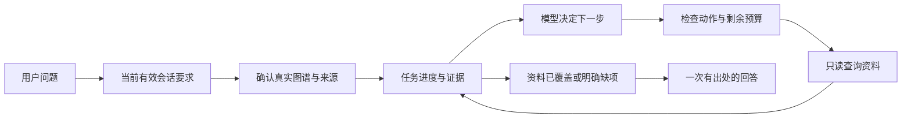

# 过程｜正式整合验收与项目讲解

覆盖原39～41，2026-10-04～05过程，2026-10-05合并。原39为整合前讲解；用户随后明确要求所有已实现机制正式接入、验收后再讲解。本文以整合版为主，统一架构、验收和口述，不把“仍是独立实验”当当前事实。原讲解保留在档案；handoff独立不合并。

## 先用普通话说明

现在它可以先记住“我们在讨论哪个疾病、你希望怎么整理”，再到真实图谱和原文中找资料。有些问题需要分几步查，它会记录查到哪一步、哪些资料找到了、哪些没有，查完后再组织回答。你改了要求或换了话题，它会更新记忆；你选择先看关联结果，也能在剩余时间内继续原任务。

因此，之前分别在实验里验证的规划、两类记忆和上下文选择，现在已经在同一个正式聊天流程里起作用。它的目标一直是：把模型的理解能力和真实资料连接起来，让查资料的过程可检查、出问题时可定位。这次整合延续了该目标。

## 一次完整问题怎样处理

例如：“查糖尿病的并发疾病，取前两个，分别整理描述和预防，用表格。”

1. 整理当前会话的有效要求。只读取这一个会话里用户明确说过的要求，取消和更正覆盖旧值；模型之前的回答不能自作主张修改用户记忆。
2. 先用真实图谱确认起点及并发关系可读，校验资料来源。图谱不可用时直接停止，避免先花模型费用却没有真实证据。
3. 程序按名称排序，从最多8个可见关系对象中选前2个。如果真实关系只有1个，就只整理这1个。
4. Flash读取任务进度，输出下一步的结构化动作，例如读取所选对象的描述和预防。程序检查对象ID、字段、已执行情况和剩余预算，再执行只读工具。
5. 结果回到任务状态：把实体、找到的字段、缺失字段和来源ID记下来。模型收到的是这些结构状态和反馈，继续决定下一步或停止。
6. 找到资料或明确缺项后，才进行一次最终回答。回答用当前要求和本任务证据，不继续带上最近10条完整旧对话。程序拒绝不完整答案或不属于当前资料的编号。

普通问题继续走既有的图谱/全文受限问答；上述多步规划支持一个起点的并发对象描述/预防切片。这样可以把已经验证的能力整合起来，范围仍保持可测试、可讲清。

## 两类记忆各记什么

| 机制 | 用普通话理解 | 正式版例子 |
| --- | --- | --- |
| 会话记忆 | 记住我们讨论的对象和当前要求 | 早先说“糖尿病、只查预防、用表格”，30条补充后仍能理解“它”；取消并换话题后改为肺炎 |
| 任务工作记忆 | 记住当前这件事办到哪一步 | 已查关系、已选对象、描述找到/预防缺失、已读动作和次数、证据编号 |
| 上下文选择 | 每次只把当下有效信息交给模型 | 保留当前问题、有效状态、当次证据；取消的旧要求不以完整旧对话再次混入 |
| checkpoint恢复 | 临时保存同一个未完任务的进度 | 先看关联结果后继续；读取次数/模型次数和原截止不重置 |

会话状态从既有登录历史重建，无额外账号表或历史迁移；游客仅保留本次会话。当前记忆理解的是明确病名和有限显式短语，不做个人病历推断、长期画像或跨会话语义回忆。

## 技术深度体现在哪里

本项目最值得讲的是模型与程序各自的职责。

模型在多步切片里负责选择下一步；控制器负责校验和执行。模型输出受限Action JSON，经PlanningHarness校验，不能直接生成任意数据库操作。只有本任务已经注册、且被选中的实体ID才能继续读取；完成/缺失字段不能重复查。错误会反馈，但同样消耗原模型预算。

工具结果进入证据仓前核对原JSON的行号、记录、字段和内容。只有可追溯资料才能进入答案，回答引用编号也必须属于当前任务。覆盖检查证明的是工程上的资料齐全程度，原医疗内容仍未专业审核。

恢复既要恢复资料，也要恢复限制。正式任务最多5次读取、4次规划、1次回答、90秒；恢复凭证由服务端签名，绑定账号/会话及metadata，只能原子占用一次。原截止继续生效，不能借“恢复”增加时间或费用。

会话记忆同样有来源。每个当前值能追到用户消息，旧值取消后保留取消状态，换话题清空；助手输出不成为用户偏好。结构状态和最终证据上下文都有字节预算，超限明确停止而不悄悄丢必需信息。

这些设计让本项目具备可观察、可验证的Agent执行流程。模型能力需要证据，安全边界由程序落实；规则回退也只能使用原剩余预算。

## 正式输入、执行与保存合同

入口[chat_runtime.py](../bishe/knowledge_graph_backend/api/chat_runtime.py)，[views.py](../bishe/knowledge_graph_backend/api/views.py)正式接线；复用PlanningHarness/ReadOnlyTools，ProductionPlanner继承已回归的Flash动作适配，普通问答保留BoundedAgent。上文的名称排序按Unicode固定，不按医学严重性选取。

服务端只读本账号选中会话，游客提交本次历史；最多2,000消息，超限明确停止。ChatMemory从user显式要求重建，不把助手答案当个人事实；源实体由原JSON/正式实体目录校验，catalog缓存以文件变更条件失效。会话结构包最多12,000 UTF-8字节，最终当前问题+有效状态+证据最多24,000字节；必需内容超限停止。回答不再外发最近10条完整旧对话；规划只拿受限任务结构和反馈，回答拿当前证据。

普通最多3检索/1理解/1回答/90秒；动态沿用上文预算，规则回退仅用原剩余额度。三阶段显式关闭默认思考、零SDK重试。最终只接受finish_reason=stop；引用校验与语义支持的区别见上文。

分步checkpoint保存在temp，签名包含nonce与metadata摘要，绑定及一次占用规则见上文。页面“先看关联结果/继续整理”、只读轨迹和安全表格接线。账号schema不迁移，正常聊天仍按既有路径保存；验收游客/内存库不写正式历史。temp不是长期证据档案或永久任务保存。

## 整合验收：模拟、真实只读和真实模型分开

| 核验 | 最终结果 | 能证明的范围 |
| --- | --- | --- |
| 后端 | 173项：153旧+20整合 | 模拟模型、内存SQLite、阻断网络，覆盖来源/缺项/隔离/取消/预算/恢复/伪造编号/截断 |
| API→SDK模拟→真实只读图谱 | 8题及另一次暂停恢复，27模拟请求 | 正式接线；P05～P08各仅1对象，没有原挑战本地故障注入 |
| 前端 | 8状态/表格检查、静态及生产构建 | 交互状态和安全文本表格；不称完整页面视觉复验 |
| 服务 | integrated_chat_v1加载、四健康200 | 当时本机服务；真实HTTP澄清/暂停0新增模型，非新质量测试 |

测试初次共享快照污染、旧mock缺引用与构建宏lint问题已修，未通过修改真实资料解测试；最终173是累计回归，不等于173道真实医疗问题。

证据：[后端日志](../temp/integration_20261005_backend.log)、[只读SDK贯通](../temp/integration_20261005_readonly.json)、[前端检查](../temp/integration_20261005_frontend_test.json)、[构建日志](../temp/integration_20261005_frontend_build.log)、[服务加载](../temp/integration_20261005_service.json)。最新173项JSON报告以temp同前缀时间戳文件为准；最终构建在temp/integration_20261005_frontend_final。只重启本项目后端，核对实际监听Python子进程PID，未重启Neo4j/前端。

## 首批最终回答失败与新批真实验收

首批范围最多16调用/保守预算2元。P01图谱及规划成功，最终回答503；3调用后停止、估算0.052623264元，没有跑剩余场景。回答输出4,095/4,096tokens，旧请求未显式关闭默认思考；结合当时官方文档可疑为思考/输出额度耗尽，但旧批缺finish_reason及reasoning统计，不伪造完全因果证明。

修复理解/回答显式thinking disabled、理解JSON、每对象字段不超过180字的原文摘录提示、最终stop结束合同、安全finish元数据及usage。用户单独批准新批最多16/2元，实际13模型调用，6API覆盖5场景，估算0.050975520元，全usage结算，无规则回退：

| 场景 | 真实观察 |
| --- | --- |
| P01糖尿病 | 2决策/3读取/1回答；尿毒症、糖尿病乳酸性酸中毒，表格/6正确来源ID |
| P02胃溃疡 | 2决策/3读取/1回答；上消化道出血、幽门梗阻，表格/6来源 |
| 31条旧历史后追问 | 保留糖尿病/只预防/表格及原消息来源，预防资料回答 |
| 取消并换话题 | 清旧字段/格式，改肺炎描述、非表格，第24行出处 |
| P07暂停/恢复 | 暂停0模型；继续2决策/1回答，累计2读取；真实只有营养不良1对象，E1～E3，不凑第二项 |

证据：[失败首批](../temp/integration_20261005_live.json)、[获批新批](../temp/integration_20261005_live_fixed.json)，各账本路径在报告。两批合计16调用/估算0.103598784元，均结束，不复用余额。金额按token/价格/预算系数估算，非账户扣款。

人工检查对象、表格/取消、编号、完整性及未把讨论对象当病历；没有全医学措辞评分。P01长节选带省略号，不能称180字连续摘录要求严格逐项通过。

真实P07恢复回包session显示clarify，但模型用的checkpoint上下文正确；之后修复有效状态展示及metadata签名覆盖，加2项→最终173。另补“不足第二对象不是字段missing”、统一[E数字]引用及不复述内部状态提示。以上收尾改动仅离线/真实只读+SDK模拟复验，未追加付费，原真实答复不篡改。

## 如何用历史实验解释技术贡献

动态实验曾2/4→3/4→3/4→4/4，规则一直4/4。程序拒绝错误后缺少反馈、停止引用不明确，补协议后又定位extra_keys并明确键集合；严格解析/评分不放松，不靠无限补跑。完整过程见[10](10_过程_动态规划与任务记忆实验.md)。这说明失败定位和Harness设计，不能说模型超过规则。

会话实验窗口代理真实3/8、结构状态8/8，只测显式合成会话对象/要求读取，预算包含共同提示，不是正式医疗答案准确率。完整过程见[11](11_过程_会话记忆与上下文工程.md)。正式接线有另一次长历史/取消验收，两类证据不能混成通用成功率。

## 面试中可以这样说

“我把一个已有医疗知识图谱问答项目改造成了有限范围的Agent。模型先理解问题；多步场景里，它根据任务状态选择下一步读取动作，程序负责校验实体、字段、证据和预算，再查真实图谱。工具结果保留原始资料出处，最后才组织一次回答。

我做了两种记忆：会话状态保留用户当前讨论对象和有效要求，支持取消和换话题；任务工作记忆保留已执行动作、缺失字段和证据。恢复任务时，原次数和截止不会重置。

我先做了独立协议实验和失败分析，再把机制并入正式聊天。整合时遇到真实回答输出额度耗尽的问题，定位请求设置后修复，并用有限真实回归检查完整流程。173项测试与只读/模拟检查支撑工程行为，真实小样本支撑接线可用；我会明确这些证据不能证明医学质量或泛化能力。”

## 常见面试追问

**为什么不直接上大型框架？** 工具/任务范围小，自己的控制器便于解释状态、执行、预算与失败；没有框架不等于创新。

**不用向量还能叫RAG吗？** 通过外部图谱/全文获取真实资料供回答。没有向量检索、微软GraphRAG社区摘要或三路融合，不靠名字暗示这些能力。

**模型和规则谁做决定？** 普通检索缺项由规则补查；有限多步场景模型根据结构观察选Action，程序核验再执行。公开状态不是隐藏思维链，当前使用JSON动作而非原生工具调用自动执行。

**到底整合了什么记忆？** 聊天历史是文本记录；会话状态是当下对象/要求及来源；任务记忆是进度/证据/预算。正式接入了后二者，仍没有跨会话画像、长期语义回忆或LLM摘要。

**全部功能都完成了吗？** 已经实现并验证的机制在有限正式范围已整合；原取消/暂缓方向不自动变成待开发。不能把有来源和工程回归说成医学审核或完整通用功能。

**个人贡献怎么说？** 区分原有前后端/图谱基础、这轮改造及AI协作，只主张自己能解释和核验的部分，不声称全部从零独立编写；简历表述按实际参与确定。

## 当前完成、边界与下一步

完成：普通问答、有限动态规划、任务工作记忆、会话状态、上下文选择、出处/动作/预算约束、规则回退、短期恢复及页面入口成为同一正式流程。当前目标延续真实资料+可检查Agent工程，用户提高了展示深度，没有转向无限医疗产品。

仍未完成：50题完整真实端到端/忠实度评估、医学审核、异机复现、通用语义冲突理解、长期结构化轨迹及跨会话长期记忆。暂缓检索细节；取消本地模型/embedding/向量/融合；待确认旧密钥废止及长期轨迹需求。恢复收尾微调无新付费复测。

唯一当前优先项是理解并能讲清正式链路、用失败与验证说明取舍，随后进入Mini SWE Agent主项目。用户不需要可运行演示；不因合并文档追加开发、测试、下载或付费。

## 原记录与证据追溯

以下链接保留原文完整过程、当次命令和全部证据路径；旧“当前/下一步”只描述当时。原文中字节不变，其相对链接仍按原Project位置解释；当前阅读以上合并正文。

- [原39：项目讲解与实习面试说明](../Old/project_process_20261005/Project/39_项目讲解与实习面试说明.md)
- [原40：正式聊天整合与验收](../Old/project_process_20261005/Project/40_正式聊天整合与验收.md)
- [原41：正式整合版项目讲解](../Old/project_process_20261005/Project/41_正式整合版项目讲解.md)
