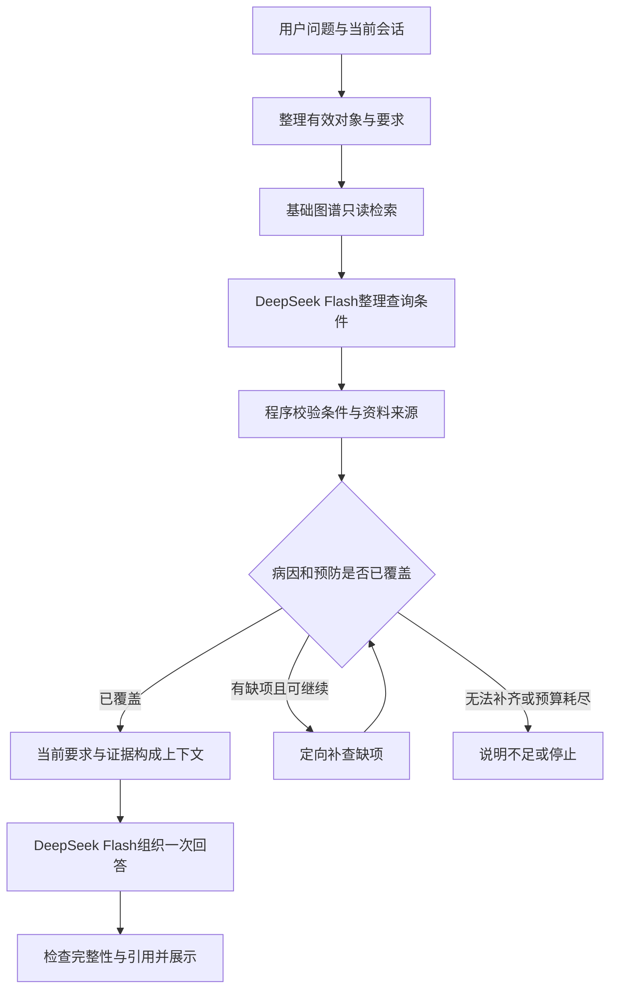

# 医疗知识图谱 RAG Agent：项目介绍与技术讲解

## 一、项目概括

### 1.1 项目做什么

这个项目面向医疗知识查询和资料整理，把大语言模型的语言理解能力与有出处的知识图谱、原文检索结合起来。用户可以用自然语言提出问题，系统将问题转成检索条件，读取真实资料，再根据资料组织回答；对于需要连续查询的问题，系统会保存任务进度，根据工具结果选择后续动作，并在资料足够、明确缺失或达到预算时停止。

项目面向普通用户，提问可以是日常表达，例如“肺炎一般是怎么引起的？平时怎么预防啊？”用户不需要知道数据库里的字段名称，也不需要先设计检索步骤或指定输出格式。系统负责识别问题涉及的对象和信息需求，查找对应原文，再组织容易理解的回答。项目还支持有限的关联对象多步整理：后续查询对象来自前一步工具结果，需要处理工具依赖和任务进度。

项目的技术重点是：让模型参与理解和决策，同时把工具执行、状态更新、资料来源、预算和停止条件交给程序核验。系统保留每次任务的结构化执行信息，便于解释一次回答如何产生，也便于定位失败发生在理解、检索、规划、记忆还是生成阶段。

### 1.2 项目背景与改造目标

项目基于已有的医疗知识图谱问答系统改造，原系统已经具备前后端、图谱查询和模型回答能力。进一步改造需要回答三个问题：

1. **资料是否可追溯？** 能返回一段文字，还需要知道它对应哪个原始记录、字段和位置，避免加工过程中引入没有依据的知识。
2. **查询过程是否能应对变化？** 首次结果不完整、后续对象来自工具发现、模型输出不合法时，系统需要有明确的继续、纠正和停止规则。
3. **多轮状态是否可信？** 早期要求不能只依赖短消息窗口；用户更正、取消或换话题以后，旧要求必须失效，任务恢复也不能重置已经消耗的预算。

因此，项目逐步形成数据与检索底座、有限规划控制器、两类状态记忆、上下文构建以及分层验收。展示时可以把这些设计作为主要贡献，结合具体失败和对照结果解释选择理由。

### 1.3 整体组成与能力范围

| 层次 | 主要组成 | 承担的职责 |
| --- | --- | --- |
| 交互层 | Vue聊天页面、会话入口、分步继续与轨迹查看 | 接收问题和要求，展示答案与当前任务状态 |
| 服务层 | Django接口、账号与会话隔离 | 组织请求，限定可读历史，保存正常聊天消息 |
| Agent运行层 | 普通检索控制器、Planning Harness、状态与上下文模块 | 选择流程、检查动作、记录进度、执行预算和停止 |
| 模型层 | DeepSeek Flash | 查询理解、有限任务动作决策、最终答案组织 |
| 知识层 | Neo4j图谱、全文索引、原始JSON与出处信息 | 提供结构关系、原文资料和可核验来源 |

正式图谱覆盖8,806种疾病、27,098个业务实体和301,314条关系。普通问答支持既有疾病字段与全文资料查询；模型动态规划目前限定为一个疾病起点的并发关系查询，以及所选对象的描述、预防资料整理。会话记忆处理明确讨论对象和有限显式要求。

这个范围使系统可以逐项检查和验证。知识资料仍保留`not_verified`，用途是知识参考与Agent工程展示，尚未完成医学专业审核。

## 二、用一个完整问题说明系统怎样工作

以普通用户的日常提问为例：

> 肺炎一般是怎么引起的？平时怎么预防啊？

用户只是用平常的说法询问原因和预防，没有要求系统“查询字段”“分类整理”或“生成表格”。识别这两类信息需求、组织检索并形成回答，是系统内部要完成的工作。

### 2.1 整理当前目标和要求

系统结合当前问题和本会话有效状态，确认讨论对象“肺炎”。这个问题没有指定输出格式，系统不会把“表格”记录成用户要求。如果用户此前更正或取消过要求，就按更新后的状态处理；助手以前回答里提到的疾病不会自动成为用户的讨论对象。

“怎么引起的”对应病因需求，“怎么预防”对应预防需求。这些日常表达需要在查询理解阶段映射到工具使用的资料字段，不能仅因为识别出了疾病名，就认为已经理解全部问题。

### 2.2 先做基础检索，再由模型整理查询条件

普通问答首先执行一次基础图谱只读检索，确认知识库可用，并保留已经找到的有效资料。查询范围限定在完成核验的正式数据中；资料核对记录、字段与原始出处。

随后，DeepSeek Flash读取当前有效问题，输出疾病、字段和检索短语等结构化条件。对于这个问题，期望条件中的疾病是“肺炎”，目标字段是病因`cause`和预防`prevent`。

程序检查字段是否在白名单中、对象是否来自当前问题、结构和数量是否符合要求。模型负责语言理解，工具按已校验条件读取资料；模型不能直接生成并执行任意数据库查询。

### 2.3 检查资料是否覆盖要求，必要时补查

控制器对已有检索结果进行覆盖检查：是否有肺炎的病因资料，是否有肺炎的预防资料，以及来源是否有效。

如果基础检索已覆盖两类资料，就保留证据并结束检索，避免再次查询相同内容。如果只找到其中一类，就依据当前缺项选择尚未执行的定向查询，再检查返回结果。这里的后续补查由规则控制器决定，不需要让模型为每一次普通查询重新规划。

这使系统既能利用首轮结果，也能发现“有资料，但没有覆盖全部要求”的情况。工具故障、原文来源异常和预算耗尽分别形成可查的停止原因，不把故障当作没有资料。

### 2.4 组织回答所需的上下文

检索覆盖需求后，系统将用户原问题、当前有效会话状态和本次证据组织为回答上下文。病因和预防资料分别保留字段、原文值、来源及证据编号，避免混淆资料类型。这里的结构化组织发生在系统内部，用户不需要用同样的格式提问。

已经取消的旧要求和无关历史不会作为完整聊天记录再次加入。若必要内容超过上下文预算，系统明确停止；若普通问答缺项仍无法补齐，也不会把部分资料当作完整依据直接生成答案。

### 2.5 生成一次答案，并检查返回结果

DeepSeek Flash根据回答上下文，用容易理解的语言回应“怎么引起”和“怎么预防”这两个问题。回答可以分段或列出要点，不要求用户事先指定表格。该阶段的任务是依据已找到的资料表达答案，不是凭模型常识补充未经检索的内容。

程序检查响应是否完整结束、是否包含引用，以及出现的证据编号是否都属于当前任务。正常回答再按现有聊天路径保存和展示。来源保留在接口资料中，普通聊天正文按既有界面设计隐藏出处标记。

普通流程最多3次检索，包含首轮基础检索，最多一次查询理解和一次最终回答。实际是否补查取决于资料覆盖情况，不能将示例中的可能分支说成每个请求都固定执行。



这个例子展示普通问答中查询理解、RAG、会话要求、上下文选择和答案检查如何协同。需要根据工具发现的对象连续查询时，系统另有有限动态规划流程，详见3.3节；两种流程各自的决策方式和预算分开说明。

## 三、技术模块与设计取舍

### 3.1 模型选择与分阶段使用

#### 为什么需要模型参与查询理解

旧检索主要依靠疾病名和关键词。用户说“征兆”“化验”“防范”，而工具使用的是症状、检查、预防等固定字段，二者需要转换。仅增加关键词规则容易不断补丁化，也很难把没有明确病名的问题组织成可用的原文检索短语。

因此，在普通RAG链路中增加一个查询理解阶段：由DeepSeek Flash将自然语言整理成疾病、字段和短语，再由程序检查，交给检索工具执行。最终回答则在拿到真实资料之后再生成。

#### 为什么选用当前方案

项目选择DeepSeek Flash作为正式模型，复用既有API接入方式，并通过小范围请求验证查询理解和动作协议。查询理解、规划决策都采用结构化输出，使结果可以在调用工具前检查。这样能围绕已有图谱和全文能力改进，无需为了语言表达转换先建立全量向量系统。

模型选择也考虑了本机维护成本。曾进行过40疾病的本地BGE对照：权重约91.9MiB，但独立运行环境约3.19GiB，另有约631MiB缓存；实验观察峰值内存约1.72GiB。小模型文件本身小，并不意味着整套部署成本小。结合当时有限题集结果和用户决定，最终退出本地模型及向量路线。

这项选择有本项目条件和实验支持，不能扩展为“DeepSeek Flash在所有任务里更强”或“向量检索不适合RAG”。本地向量使用40疾病样本，DeepSeek Flash检索全量图，候选范围不同，不是公平的全量模型排名。

#### 同一个模型承担哪些不同职责

| 阶段 | 主要输入 | 输出 | 输出后由谁处理 |
| --- | --- | --- | --- |
| 普通查询理解 | 当前有效问题 | 疾病、字段、检索短语JSON | 程序校验后选择图谱/全文查询 |
| 多步规划决策 | 当前任务、注册对象、字段进度、反馈、剩余预算 | 一项读取或停止Action JSON | Harness检查后执行或拒绝 |
| 最终回答 | 当前要求与已核验资料 | 自然语言/表格答案 | 程序检查结束状态与引用 |

检索前后的两次模型使用体现职责分工：先理解怎样查，再依据查到的资料表达答案。多步流程可能有多次决策，因此不能称整个项目固定只调用两次。当前没有多模型路由器，也没有为不同模块训练独立模型。

普通理解输出例如：

```json
{
  "medical": true,
  "diseases": ["肺炎"],
  "fields": ["prevent"],
  "keywords": []
}
```

程序限制数量、字段和长度；疾病必须出现在交给理解器的当前问题中，不允许根据症状猜疾病。会话指代先由本地状态按明确对象归一化。模型不能输出任意Cypher来绕过工具。

查询理解最多一次、输出上限600tokens；规划每次最多300输出tokens，使用JSON格式、低随机性设置及关闭自动重试。模型请求显式关闭思考模式。这里保留的是结构化动作和反馈，未收集或展示隐藏推理。

#### 如何判断这项改动有用

冻结12题的历史真实理解/检索对照中，原baseline通过2/12，增加DeepSeek Flash理解后通过10/12，实际11次理解调用。这说明该小题集的表达转换改善了检索，不是最终答案准确率。剩余省略追问和名称边界失败仍保留，没有据此宣布通用中文理解完成。

### 3.2 RAG：图谱检索与全文检索

#### 为什么需要外部知识

项目要展示的是基于实际资料的查询与整理。单靠模型内部知识，很难逐条说明答案来自哪份项目数据；生成内容与数据库实际记录之间也可能不一致。因此，回答前先读取外部知识，再把带来源的资料提供给模型。

知识库来自原始医疗JSON。处理时保留源文件哈希、原始记录、行号、字段及列表位置，排除占位和无法核验的加工项，不把商品详情自动推导成厂家或品牌知识。全量处理后8,806疾病的业务图成为正式检索范围。

数据工程为RAG提供一致的资料底座：导入默认离线，实际写入绑定目标和输入；重复导入不能覆盖冲突内容；全量分批提交、失败保留已提交进度，完整核验后才标为可检索。这样可以区分“工具没查到”和“库处于未完成状态”。

#### 两种检索分别解决什么问题

| 检索方式 | 适合的输入和用途 | 具体实现 | 当前局限 |
| --- | --- | --- | --- |
| 图谱检索 | 明确疾病、资料字段、实体间关系 | 限定数据范围的固定Cypher与关系/字段白名单；多步工具按注册ID读取 | 复杂否定、多条件反查、名称边界和完整列表仍有已知限制 |
| 全文检索 | 没有明确疾病名，但有可查的原文短语；寻找描述、病因、预防中的文字 | Neo4j全文索引召回候选，再检查原文实际含短语与出处一致性 | 字面匹配不等于语义召回，复杂同义改写或不在原文中的表达可能失败 |

图谱适合明确关系和对象依赖，例如“糖尿病有哪些并发对象”；全文能利用节点中的连续原文，补充只按病名匹配无法进入的资料。二者对应现有数据的结构与文本特征，输出都转成带来源的事实，便于后续统一覆盖检查。

当前全文索引作用于现有疾病节点的名称和原文属性；工具进一步核查描述、病因和预防。项目另准备了149,975个可追溯文本片段，覆盖六类资料，但这些片段保存在磁盘，未作为149,975个独立节点入库，不能把它们全部说成线上全文搜索单元。

#### 为什么先做查询组织，再让工具执行

全文工具需要可检索短语，不能把任何整句问题都当成原文。早期实验中，8个固定原文短语均找到目标资料，而将既有50个自然问句整句交给字面工具没有命中。这支持在检索前增加查询组织：把用户表达转换为字段或具体短语。

普通流程先有一个只读图谱baseline，再由模型理解条件。明确疾病和字段优先定向查询；需要原文匹配时使用受限全文短语。每次工具返回后重新检查缺项，必要时补查。它是带条件和反馈的检索流程，没有实现图、全文、向量三路统一评分融合。

向量检索曾作为实验选项，当前已停用。现在采用图谱与全文取得外部资料，仍然是检索增强生成；面试时应直接解释实际检索方式，不以RAG名称暗示不存在的向量能力。

### 3.3 规划与工具调用：模型动作和程序执行的分工

#### 为什么要从固定检索走向反馈循环

一次理解后执行固定查询，适合简单问题。但多步例子中，下一批对象要从关系工具结果取得；资料缺失、临时失败和停止条件也要在运行过程中判断。提前列出一条静态计划，不能自动解决全部观察变化。

项目为此保留两个层次：普通问题用规则驱动的有限检索控制器；支持的多步任务用DeepSeek Flash读取结构化观察、提出下一项动作。程序继续掌握工具执行权限和状态更新，不把数据库操作直接交给模型。

#### 为什么保留规则基线

简单查询的规则路径更容易复现，也无需增加每一步模型请求。对于共享模板的规划挑战，规则策略本来就能完成。因此，动态模型有机会处理观察与动作，但其价值必须通过对照证明，不能预设“用了Agent就一定优于规则”。

这个项目选择有限的模型决策范围，便于研究协议遵循、失败反馈和停止，同时保留稳定基线。动态分支入口和对象排序由程序确定；模型决定后续合法动作，不负责开放式医学筛选或任意任务拆解。

#### 工具动作怎样约束

| 动作 | 允许范围 | 关键检查 |
| --- | --- | --- |
| `read_relations` | 读取注册起点的指定并发关系 | 起点、关系类型、资料范围和来源 |
| `read_fields` | 读取已选对象的描述/预防 | 对象来自当前工具观察，字段合法且未处理完毕 |
| `stop` | 提出完整、部分或受阻状态 | 资料进度、必需关系/字段引用与状态一致 |

模型返回严格JSON。控制器拒绝额外键、未知动作、未注册实体、无效引用和重复动作。实际查询来自预定义工具，使用只读事务及参数化值；当前不是把原生`tool_calls`直接交给SDK自动执行。

工具观察与动作拒绝都形成反馈，包括上次结果、安全拒绝码、已处理缺项、仍可读字段和必需停止证据。明确缺失表示已经处理过，不能无限重复查；仅声明的临时错误允许有限重试。

普通流程最多3次检索，包含baseline，最多一次理解和一次回答；动态任务最多5次实际读取、4次模型决策、一次回答。两者总截止均为90秒，具体SDK和事务超时取剩余预算。读取两个对象按两次实际读取计，不用一次批量包装美化成本。迟到结果丢弃；这不是强制杀掉任意同步阻塞线程的保证。

模型决策耗尽或特定策略错误时，可在原剩余读取/时间预算内用规则回退，不重新开额度。轨迹标明是否回退，不能把规则接手后的完成全部归为模型能力。

#### 一个能说明设计价值的失败

首次四题真实规划，模型严格通过2/4，规则4/4。失败包括：查齐字段后停止时漏引用发现对象的关系证据，以及反复读已确认缺失的预防字段。

程序拦住了这些动作，但下一请求没有明确收到拒绝原因，停止必需引用也未单列。补齐反馈后真实回归3/4，仍有格式失败；增加安全结构诊断后，定位到新的读取动作多了协议外字段。随后明确每种动作完整键集合，最后一次同题严格4/4，规则仍4/4。

原评分始终保留“出现非法动作即失败”，即使后面完成也不改判；没有剥掉额外字段自动放行。这个案例展示协议、反馈、诊断和回归的工程深度。四题已用于开发，不能据单轮结果说模型更强或具有泛化收益。

### 3.4 记忆系统：会话要求与任务进度分别维护

#### 为什么聊天历史还不够

数据库保存消息解决了历史可查看问题，但下一次模型调用只拿最近若干条时，早期仍有效的要求可能丢失。多步任务还要知道哪些工具已执行、哪些字段确认缺失、证据放在哪里和用了多少预算，这些信息也不能仅靠重新阅读聊天文字猜测。

因此，项目把会话记忆和任务工作记忆分开维护。这样既能更新用户意图，又能保持工具执行的一致性。

| 记忆 | 保存内容 | 作用 |
| --- | --- | --- |
| 会话状态 | 当前讨论对象、有效资料/格式要求、来源消息ID、版本、主题与生效状态 | 解析追问，处理更正、取消与话题变化 |
| 任务工作状态 | 目标、注册对象、字段进度、证据索引、已执行动作、失败次数和剩余预算 | 让下一动作基于真实进展，支撑短期恢复 |
| 聊天历史 | 用户/助手原消息 | 支持界面历史及会话状态重建 |

#### 为什么用结构状态，而没有先加摘要模型

本项目的首批需求是明确病名、只查预防、表格、更正、取消和换话题。对这些有限表达，可以直接更新带来源的字段，不需要再用一个模型总结全部历史。字段的写入和失效更容易检查，也避免摘要把取消要求误压缩为仍有效偏好。

每次状态更新附来源和版本；改查替代旧对象，取消留下失效状态，换话题清除旧目标与要求。只接收本会话用户的明确表达，助手提到新病名不会改变用户状态。讨论某种疾病也不被解释为用户患病。

例如，早先说“讨论糖尿病，只查预防，用表格”，很多轮后问“它的资料呢”，有效状态仍能提供对象和要求。后来取消要求、换到肺炎，旧字段和格式不再注入。有多个可能对象时返回澄清，不能单凭最近病名强猜。

登录状态从本账号当前会话的既有历史重建，没有新增独立画像表；游客使用本次提交历史，刷新行为仍按游客会话设计。读取上限2,000消息，超限停止。当前支持有限显式表达，不是通用中文状态抽取、跨会话长期语义记忆或个人病历管理。

任务工作记忆由控制器维护，模型只能提动作，不能直接修改证据、次数或余额。它的意义是保存已经确认的事实状态和执行约束；模型不必从上次自然语言答案中重新推断任务做到哪里。

### 3.5 上下文工程：每次模型请求提供什么

#### 为什么记住信息以后还要选择上下文

状态保存完整，不表示应该把全部历史和原文都放进每次请求。用户已经取消的要求、助手无关内容、过长原文和过期对象会占用输入，也可能让模型误读当前任务。上下文管理需要根据本次角色挑选有效信息，并保持稳定的组织方式。

项目采用“收集有效状态→过滤失效和无关内容→按职责组织→完整预算检查”的方式。这里的选择主要通过结构字段投影，不依赖向量相关性排名或LLM摘要。

#### 三个阶段的输入怎样分开

查询理解以当前有效问题为输入，不上传整个聊天历史。会话中的明确指代在本地归一化，模型只负责整理这次可查条件。

规划模型看到当前任务、注册对象、字段状态、证据ID、动作反馈和额度；不需要全部证据正文即可决定下一步。原文详细值保存在证据仓，由工具/程序验证。

最终回答模型看到当前问题、仍有效的会话要求和本任务资料，利用正文组织答案。正式链路不再将最近10条完整旧对话同时发给回答模型，避免被已取消的旧表达重新影响。

会话结构包最多12,000 UTF-8字节，规划适配消息另有12,000字节边界，最终回答所构建的问题/状态/证据上下文最多24,000字节。必需信息放不下则停止，不截半个约束后假装完整。字节数是可验证的输入保护值，不是精确token数；实际usage单独记录。

#### 为什么这项选择有实验依据

冻结8条显式合成会话，在相同模型、提示和每题输入字节预算下，比较预算匹配的最近10条窗口代理与结构状态。真实读取对象/要求任务中，窗口严格3/8，结构状态8/8。

窗口失败包含状态/对象一致性错误、早期要求丢失、更正误读和助手提及污染。其中早期要求已经不在输入里的案例，改善首先来自程序保留有效状态；不能说模型凭空恢复了记忆。

这比较的是整个上下文方案；窗口代理不是原正式API，题集是合成显式表达、作者可见，也没有随机重复来证明稳定省费或更快。结果支持本项目的状态选择设计，不能泛化为所有长对话都可靠。

### 3.6 证据管理与答案检查

#### 为什么检索完成后还需要核验

检索返回一条资料，仍可能对象错误、字段不匹配、位置不一致，或者回答引用了不存在的编号。若这些问题不在进入答案前发现，模型可能把错误依据组织成流畅文字。

因此，项目维护从原始数据到最终编号的来源链：源文件哈希、记录与行号、疾病/字段、列表位置或原文值，经工具和来源检查后进入本任务证据仓，再分配E编号。规划停止要求包括对象发现的关系证据与已找到的字段证据，不能只引目标资料而漏掉“这些对象怎样选出”。

最终回答程序检查两项：响应必须完整结束；必须含证据编号，且所有出现的编号属于当前任务。失败不按正常答案保存。检查能拦截伪造编号和不完整输出，但未逐句确认每个断言被所引原文支持。

#### 为什么保留程序检查的范围

来源一致性、ID归属和结束状态可以明确实现与测试。语义忠实性和医学正确性需要额外标注或专业审核，若未经校准直接增加模型自评，仍不能把自评结果当成可靠标准。

因此，现阶段明确区分四层：出处可追溯、字段覆盖、引用合法、语义与医学审核。前三层有相应工程机制，最后一层尚未完整完成。面试中可以展示可检查的保证，同时准确说明保证止于哪里。

正式整合首批真实任务曾在最后回答阶段503，规划和资料已齐，回答输出接近4,096token上限。检查发现旧请求未显式关闭默认思考，后续补请求配置、完整结束条件和安全元数据；获批新批通过有限回答验收。旧请求缺完整finish记录，不能把推测写成彻底证明的根因。

### 3.7 中断恢复与运行可观察性

#### 为什么恢复不能只保存几条消息

用户选择先看关联结果，再继续整理时，系统需要沿用已发现对象和证据，不能从头查同一关系，也不能让90秒截止或调用额度重新开始。恢复功能同时要保留进度和限制。

checkpoint保存任务状态、证据仓、已用次数和有效期；恢复核对任务与数据版本、来源完整性，再继续未完成部分。正式恢复凭证由服务端签名，绑定账号/会话、nonce及metadata摘要，原子占用一次。签名身份约束与内容/证据哈希核验各有职责。

这个方案使用临时文件，没有迁移正式账号模型，适合当前短任务分步；它只支持原90秒截止内继续，不能隔天无限续做。页面提供“先看关联结果”和“继续整理”，过期或重复凭证明确拒绝。

执行轨迹记录动作、受限参数、观察、证据、次数和停止原因。实验工具还能保存并离线重放结果，便于分析理解失败、格式拒绝、工具故障或预算停止。轨迹不包含模型隐藏推理；临时checkpoint和报告也不是长期正式审计平台。

### 3.8 评测与失败驱动的改进

#### 为什么要分层验证

模拟测试能准确制造非法动作、缺失、超时和恢复场景，但正确的模拟输出不能证明真实模型会遵守协议。真实只读工具能核对数据接线，却不能证明最终答案质量。小批次真实模型则能暴露实际响应问题，但样本有限、成本和授权范围也需要控制。

项目将三类证据分别报告，并在新增机制前冻结题集、标准与预算。oracle只供评分，模型不能看到后续正确对象或标准答案。正常、缺失、错误、恢复都保留，失败请求也计入次数和费用。

| 验证层次 | 已有证据 | 主要证明什么 |
| --- | --- | --- |
| 工程回归 | 最终173项后端测试；模拟模型、内存账号库、阻断网络 | 协议、来源、状态、权限、预算、恢复和异常边界 |
| 实际工具贯通 | 正式API+SDK本地模拟+真实只读图谱8题及恢复，27模拟请求 | 正式模块能串接真实资料；未执行原挑战故障注入 |
| 真实规划实验 | 最后四开发题严格4/4，规则同为4/4 | 当轮动作协议和执行回归，未显示胜过规则 |
| 真实上下文实验 | 窗口代理3/8、结构状态8/8 | 有限合成会话中状态读取差异 |
| 真实正式整合 | 两道多步、长历史、取消换话题、暂停恢复；获批新批13模型调用 | 这些狭窄场景下正式理解/执行/回答可用 |

正式整合的失败首批3调用估算0.052623264元，新批13调用估算0.050975520元；合计16调用估算约0.104元。估算依据返回usage与当时价格/预算系数，不是账户扣款。批次均已结束，不从剩余额度自动补跑。

真实恢复验收后还发现状态显示不一致及表述瑕疵，随后补有效状态展示、metadata签名和提示约束，完成离线及只读模拟回归，未再次付费。这一点意味着真实报告与最终收尾代码不是逐项再次真实复验，介绍时应保留该区别。

完整50题真实端到端、逐句忠实性、医学专业审核、异机复现、跨会话长期记忆和长期结构化轨迹仍未完成。已验证的数字分别属于不同层次，不能相加成“系统医疗准确率”。

## 四、汇报时怎样串起这些模块

讲解可以沿着第二部分例子展开：用户表达先变成有效目标，图谱与全文提供知识，控制器组织查询，模型在有限任务中根据观察选择动作，记忆保存要求和进度，上下文模块选择本次输入，证据和预算检查决定何时可以回答或必须停止。

技术选择都能回到具体问题：关键词不够灵活，所以加入查询理解；后续对象依赖查询结果，所以研究动态规划；消息窗口可能丢要求，所以保存带来源的会话状态；完整历史可能带回过期约束，所以进行上下文选择；模型可能犯格式和引用错误，所以保留程序核验与拒绝反馈；分步继续不能重开额度，所以恢复同时保留状态和预算。

可以用以下表述概括项目：

> 我在已有医疗知识图谱问答系统上，增加了可追溯检索、有限规划控制器、两类状态记忆和上下文管理。普通问题由模型整理查询条件，再查图谱或全文；多步任务让模型读取工具观察，提出结构化动作，由程序检查对象、字段、证据和预算后执行。
>
> 我保留了规则基线，用冻结任务和失败轨迹验证设计。真实规划出现过漏引用、重复缺项和额外字段，改动围绕反馈协议和严格校验进行；会话实验则验证了在有限输入预算下保留有效状态的作用。已验证机制后来整合到正式聊天，支持带预算的分步继续和一次最终回答。
>
> 这个项目的重点，是把模型决策、程序约束与验证证据连接起来。我会把工程回归、真实小样本和医学质量区分说明，明确当前支持范围和剩余工作。

个人贡献需要结合真实参与表达：原系统基础、这轮改造内容、AI协作参与和自己能独立解释/复现的部分分别说明，不把整个原项目宣称为从零独立实现。

## 附录：实现和实验的查阅入口

模块划分参考[Hello-Agents官方目录](https://github.com/datawhalechina/hello-agents)，其中[第四章](https://github.com/datawhalechina/hello-agents/blob/main/docs/chapter4/%E7%AC%AC%E5%9B%9B%E7%AB%A0%20%E6%99%BA%E8%83%BD%E4%BD%93%E7%BB%8F%E5%BC%8F%E6%9E%84%E5%BB%BA.md)讨论经典Agent范式，[第八章](https://github.com/datawhalechina/hello-agents/blob/main/docs/chapter8/%E7%AC%AC%E5%85%AB%E7%AB%A0%20%E8%AE%B0%E5%BF%86%E4%B8%8E%E6%A3%80%E7%B4%A2.md)讨论记忆与RAG，[第九章](https://github.com/datawhalechina/hello-agents/blob/main/docs/chapter9/%E7%AC%AC%E4%B9%9D%E7%AB%A0%20%E4%B8%8A%E4%B8%8B%E6%96%87%E5%B7%A5%E7%A8%8B.md)讨论上下文工程。本文按本项目实际能力展开，没有声称完整实现教程框架或其全部机制。

| 本文主题 | 实现入口 | 设计及验证入口 |
| --- | --- | --- |
| 正式问答与整合 | [chat_runtime.py](../bishe/knowledge_graph_backend/api/chat_runtime.py)、[views.py](../bishe/knowledge_graph_backend/api/views.py) | [正式整合验收](12_过程_正式整合验收与项目讲解.md) |
| 查询理解与模型使用 | [query_planning.py](../bishe/knowledge_graph_backend/api/query_planning.py)、[utils.py](../bishe/knowledge_graph_backend/api/utils.py) | [路线选择与对照](08_过程_全文检索与DeepSeek路线调整.md) |
| 图谱/全文检索 | [graph_retrieval.py](../bishe/knowledge_graph_backend/api/graph_retrieval.py)、[fulltext_retrieval.py](../bishe/knowledge_graph_backend/api/fulltext_retrieval.py) | [数据工程](06_过程_图谱数据工程与正式部署.md)、[检索基线](07_过程_检索基线与聊天验收.md) |
| 普通规则闭环 | [agent_loop.py](../bishe/knowledge_graph_backend/api/agent_loop.py)、[read_tools.py](../bishe/knowledge_graph_backend/api/read_tools.py) | [闭环实现与复审](09_过程_Agent闭环与技术深度复审.md) |
| 动态规划/任务状态 | [planning_runtime.py](../bishe/knowledge_graph_backend/api/planning_runtime.py)、[planning_tools.py](../bishe/knowledge_graph_backend/api/planning_tools.py)、[deepseek_planner.py](../bishe/knowledge_graph_backend/api/deepseek_planner.py) | [规划与失败修复](10_过程_动态规划与任务记忆实验.md) |
| 会话状态/上下文 | [conversation_context.py](../bishe/knowledge_graph_backend/api/conversation_context.py) | [同预算会话实验](11_过程_会话记忆与上下文工程.md) |
